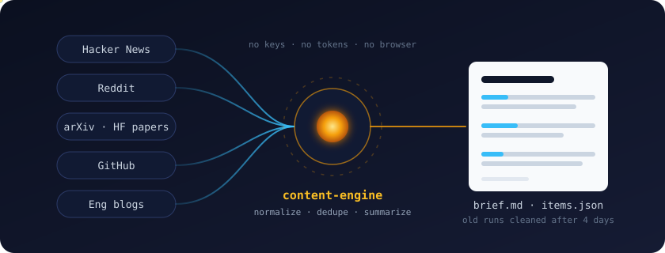

<p align="center">
  
</p>

<h1 align="center">content-engine</h1>

<p align="center">
  <b>Today's tech &amp; AI news, papers, repos and discussions, collected into one clean brief.</b><br>
  No API keys. No LLM tokens. No browser automation.
</p>

<p align="center">
  
</p>

<p align="center">
  <a href="#quick-start">Quick start</a> ·
  <a href="#what-you-get">What you get</a> ·
  <a href="#sources">Sources</a> ·
  <a href="#run-it-on-a-server">Run it on a server</a> ·
  <a href="#add-a-source">Add a source</a>
</p>

---

## Quick start

You need [uv](https://docs.astral.sh/uv/) (it installs Python for you).

```sh
git clone <repo-url> content-engine && cd content-engine
uv sync                                # install
uv run content-engine run --print      # fetch everything and print the brief
```

That's it. The run takes a few seconds and writes its results to `./data`. While it runs
you see a spinner with the current step; when it's done, it prints a one-line result
(`✔ 37/37 sources · 163 items · 6.8s`), plus a line for any source that failed.
Add `-v` to see the full log.

## What you get

Each run reads about 40 public sources, keeps the interesting items, and writes two files you'll
actually use:

| File | What it is |
|---|---|
| `data/latest/brief.md` | A readable brief, grouped by topic. Paste it into an agent's prompt, or just read it |
| `data/latest/items.json` | The same items as data, all in one shape |

A line of the brief looks like this:

> **[Firecracker VM Escape: PwnEscape Part 2](https://pwn.ai/blog/firecracker-escape)** (`lobsters_ai` | Discussion)
> Firecracker is supposed to keep untrusted code inside a microVM. We escaped it and achieved code execution as root on the host.

And every item in `items.json` has the same fields:

```json
{
  "id": "hn:50437106",
  "source": "hacker_news",
  "category": "community",
  "title": "Fireworks AI security breach impacts Notion and their customers",
  "url": "https://www.notion.com/help/security-incident-involving-a-third-party-ai-vendor",
  "summary": "This notice is about the security incident at one of our vendors, Fireworks AI...",
  "metric": "33 pts | 7 comments",
  "published_at": "2026-11-10T07:19:38Z",
  "delivered": false,
  "also_in": []
}
```

**About summaries.** A summary is always the source's own words, up to 250 characters. If
it's longer, it's cut with "..." and the link has the rest. When a feed gives no summary at
all (most Hacker News links), the engine opens the linked page and uses the preview text the
publisher wrote for it. Nothing is rewritten and no AI is involved.

## Sources

| Topic | Where it comes from |
|---|---|
| **Agent AI** | Anthropic engineering · LangChain · GitHub AI blog · Microsoft Agent Framework · Latent Space · Simon Willison · The New Stack · arXiv cs.MA · new agent repos on GitHub · OpenAI Agents SDK and MCP spec releases · Hacker News (agents) · r/AI_Agents |
| **Physical AI** | NVIDIA robotics (blog and developer blog) · The Robot Report · IEEE Spectrum robotics · Robohub · Weekly Robotics · arXiv cs.RO · new robotics repos on GitHub · LeRobot and Isaac Lab releases · Hacker News (robotics) · r/robotics |
| **Community** | Hacker News · Reddit (r/LocalLLaMA, r/MachineLearning) · Lobsters · Techmeme |
| **Research** | Hugging Face daily papers · arXiv (cs.AI, cs.LG, cs.CL) |
| **Tooling** | New LLM repos on GitHub · llama.cpp releases · vLLM releases |
| **Engineering blogs** | Anthropic research and science · Google Research · OpenAI · Meta Engineering · Cloudflare |

Agent AI and Physical AI are the focus topics, so they come first in the brief.
`uv run content-engine sources` prints the live list.

## Commands

```sh
uv run content-engine run              # fetch, save, and delete data older than 4 days
uv run content-engine run --print      # same, and print the brief
uv run content-engine run --plain      # no spinner, plain log lines (automatic on servers)
uv run content-engine run --new-only   # brief.md lists only items no earlier brief had
uv run content-engine sources          # list the sources
uv run content-engine clean --dry-run  # show what the cleanup would delete
uv run pytest -q                       # run the tests (no internet needed)
```

## It cleans up after itself

Every run is saved in its own folder under `data/runs/`. Anything older than **4 days** is
deleted automatically at the end of each run, so the disk never fills up. Change the number
with `--retention-days 7` or the `CONTENT_ENGINE_RETENTION_DAYS` setting.

```
data/
  latest/             the newest brief.md and items.json
  runs/<timestamp>/   one folder per run (items, trending, brief, report), kept for 4 days
  status.json         did the last run work? which sources failed?
  history.jsonl       one line per run
```

## Trending topics

The top of `brief.md` is a short list of what is being talked about most, so you can stop
reading after it:

- **Trending topics** (up to 5): a name that several unrelated sources are writing about
  (for example a CEO resigning, covered by Reddit, a newsletter and a news site), or one
  link that more than one source carried (a blog post that is also on Hacker News).
- **Most discussed**: the Hacker News stories with the most points, up to 3, above 50 points.

It is worked out from `items.json` with plain rules, no AI: names are recognised by how the
feeds capitalise them, and a source writing about itself (NVIDIA's blog naming NVIDIA)
doesn't count. The result is also saved as `trending.json`, and the labels are listed in
`report.json` as `trending_topics`. On a quiet day there may be none, or only one.

## New vs already delivered

The engine remembers what earlier runs carried, so you can tell fresh news from repeats:

- **`items.json`**: each item has `delivered`. `false` means no earlier run had it; `true`
  means it was already in a previous brief.
- **`brief.md`**: written from `items.json`, with the trending topics first, then a **New**
  part and an **Already delivered** part. `--new-only` leaves the last part out.
- **`report.json`**: per source, how many items were `new` and how many `already_delivered`.

Every run keeps its own `items.json`, so you can go back to any run from the last 4 days
and see what was new at that moment.

## Is it healthy?

Open `data/status.json`. If `health.alert` is `false`, everything is fine. If it's `true`,
`health.reasons` says why in plain English, for example
`"techmeme failed 3 runs in a row"`. One source failing never stops the others.

## Run it on a server

To have it run every hour on Linux, use the ready-made files in [`deploy/`](deploy/):
a **systemd timer** or a **cron job**, plus a small script that adjusts them to your paths.
The step-by-step guide is [`deploy/README.md`](deploy/README.md). It also covers hooking
the health check into a monitoring dashboard.

## Add a source

Most sources are one line in [`src/content_engine/sources.py`](src/content_engine/sources.py).
For any RSS or Atom feed:

```python
FeedCollector("huggingface_blog", "engineering_blogs", "https://huggingface.co/blog/feed.xml", 4, "Blog"),
```

The arguments are: a name, a topic, the feed URL, how many items to take, and a label.
The topic is one of `agents`, `physical_ai`, `community`, `research`, `tooling`,
`engineering_blogs`. For a feed that posts rarely, add `max_age_days=30` so old posts
don't sit in every brief.
Run `uv run content-engine run --print` and it shows up in the brief.

## Use it from Python

```python
import asyncio
from datetime import datetime, timezone
from content_engine.engine import run
from content_engine.render import to_markdown
from content_engine.sources import default_collectors

result = asyncio.run(run(default_collectors()))
brief = to_markdown([item.to_dict() for item in result.items], datetime.now(timezone.utc))
```

Used this way nothing is saved, so every item counts as new. The `delivered` marking
happens when the CLI saves a run.

## More

- [`deploy/README.md`](deploy/README.md): server setup, monitoring, maintenance
- [`CLAUDE.md`](CLAUDE.md): how the code is organised and the rules it follows
- [`docs/project_engine_instructions.md`](docs/project_engine_instructions.md): the original spec
